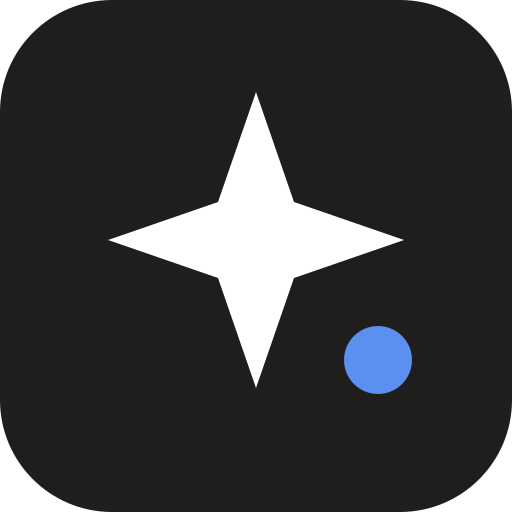
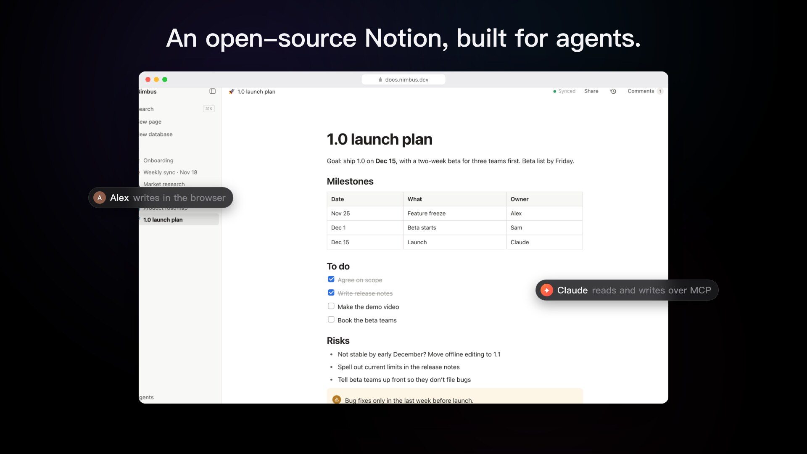
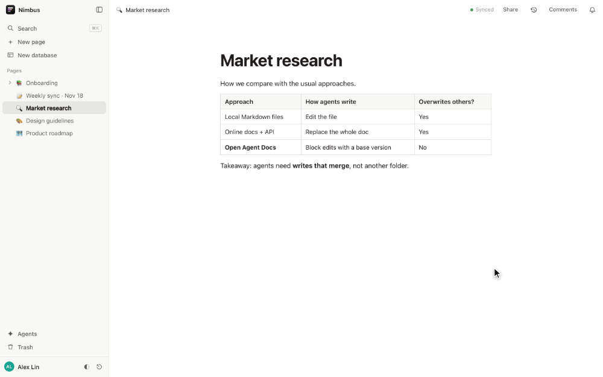
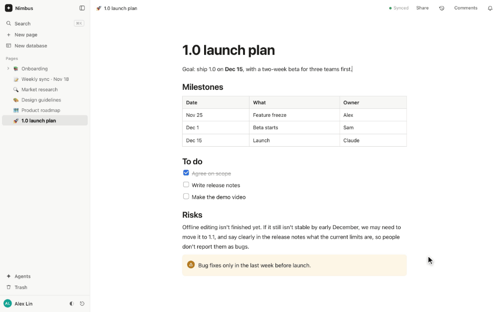
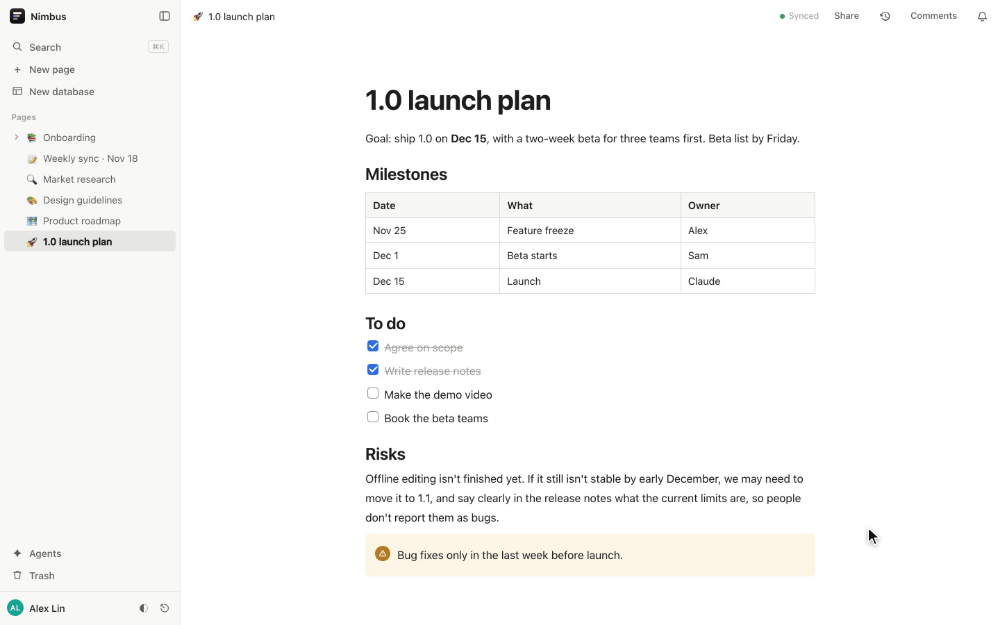
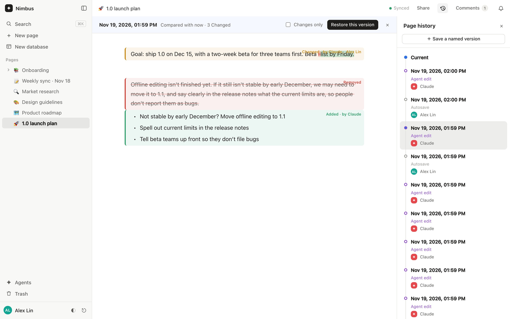
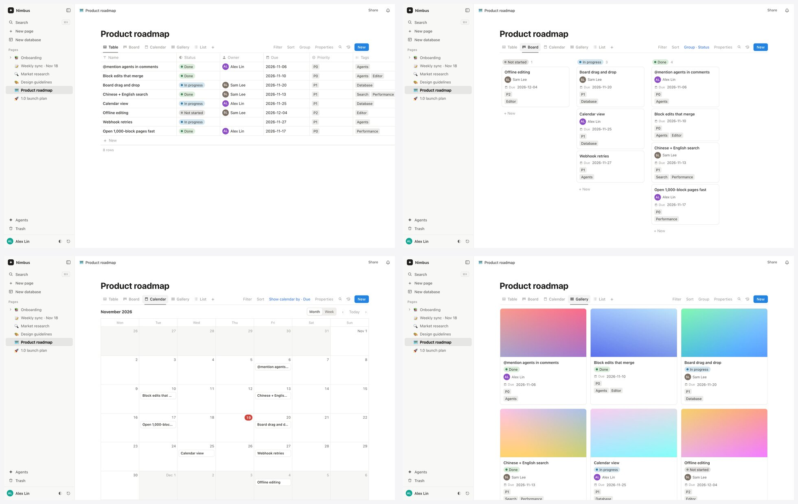
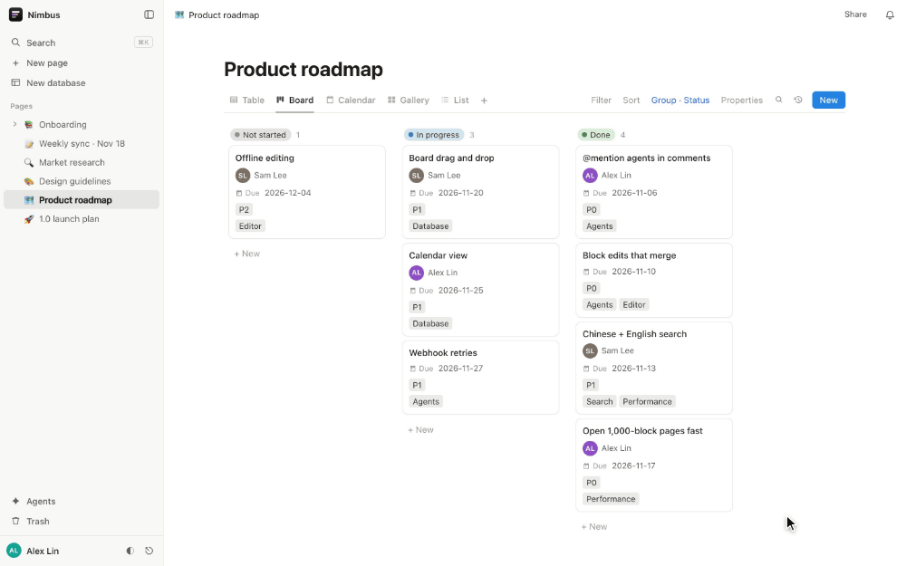
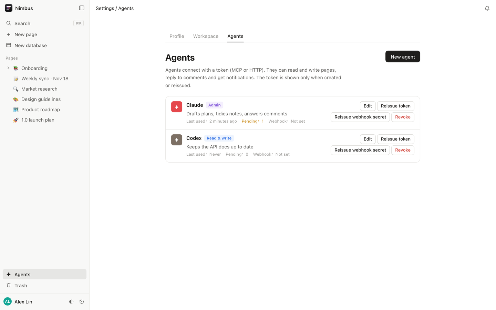

# Open Agent Docs

English | [简体中文](README.zh-CN.md)

Docs that people and AI agents write together. Think of it as an open-source Notion, built for agents.

A self-hosted document server. Agents (Claude Code, Codex, bots, your own scripts) read and write pages over MCP; people edit,
comment and build databases in the browser, live, alongside them.



### Agents write into the page, live

Hand Claude a task in Claude Code and watch the page fill in, block by block. The top bar shows who is writing, and hovering a
block shows who wrote it.



### Block-level edits that merge

Pages read as Markdown with a block id before each block. Agents change just the blocks they mean to and pass back the version
they read; the server merges, so nobody's typing is overwritten.



### Comments that reach agents

Select some text and @mention an agent, or comment on something it wrote: it gets a notification (webhook, SSE or polling)
with a ready-made prompt, makes the change and replies in the thread.



### Every change on the record

Version history shows which edits came from people and which from agents, with a diff for each, and restores any version.



### Databases

Table, board, calendar, gallery and list views; select, status, date, person, files, formulas, relations, rollups, unique ids,
buttons. Every row is also a page, and agents query and fill databases too.





### And the rest

- **Real-time editor for people.** Collaborative block editor with presence, subpages, trash, public share links, search
  (Chinese and English), English and Chinese UI, dark mode, works offline as a PWA.
- **Embeddable.** Drop it into your app with an iframe, or use the `@oad/client` and `@oad/editor` packages with your own sign-in.
- **One binary, one data directory.** Rust server with the web app built in; SQLite. Under 30 MB, starts in about 20 ms,
  idles at about 17 MB, searches 100,000 paragraphs with a p95 under 9 ms ([numbers](docs/baseline.md)).

## Run it

```sh
docker build -t open-agent-docs .
docker run -d -p 8848:8848 -v oad-data:/data \
  -e OAD_ADMIN_EMAIL=me@example.com -e OAD_ADMIN_PASSWORD='choose one' open-agent-docs
```

Open http://127.0.0.1:8848. For the binary and building from source, see [Quick start](docs/en/quickstart.md).

Connect Claude Code (create the agent and its token under **Agents** in the web app):




```sh
claude mcp add --transport http docs http://127.0.0.1:8848/mcp --header "Authorization: Bearer oad_..."
```

## Documentation

- [Quick start](docs/en/quickstart.md) · [Configuration](docs/en/configuration.md) · [Deployment](docs/en/deployment.md)
- [Agents](docs/en/agents.md) (MCP, notifications, webhooks) · [Markdown for agents](docs/en/markdown.md)
- [Embedding](docs/en/embedding.md) (JS packages, iframe, header auth, JWT)
- [Migrating from the old Python version](docs/en/migration.md)

## Development

```sh
pnpm install && sh packages/db-wasm/build.sh
cargo run -p oad-bin -- serve        # server on :8848
pnpm dev                             # web app with hot reload, proxies /api to :8848
pnpm -r test && cargo test           # tests
```

The previous Python version is tagged `python-final` in git; to move its data over, see [migration](docs/en/migration.md).

## License

MIT
