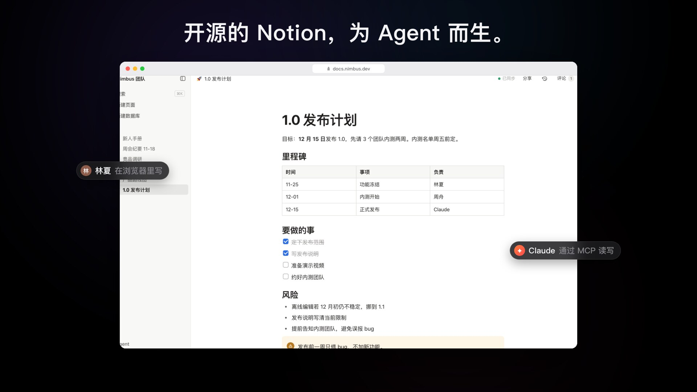
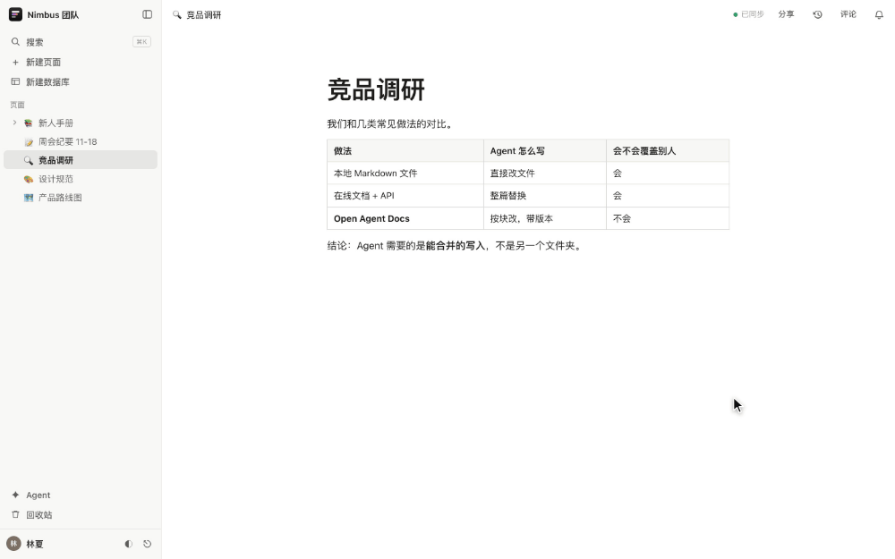
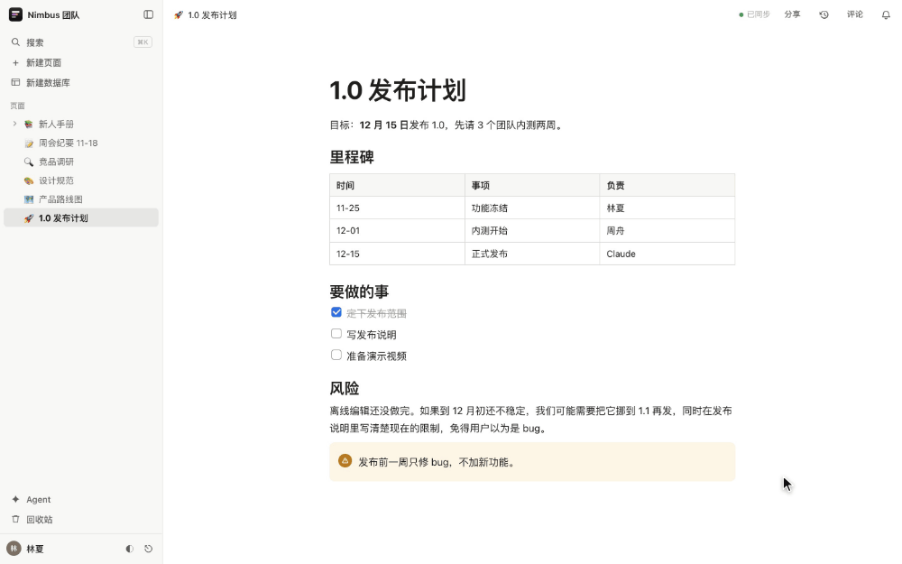
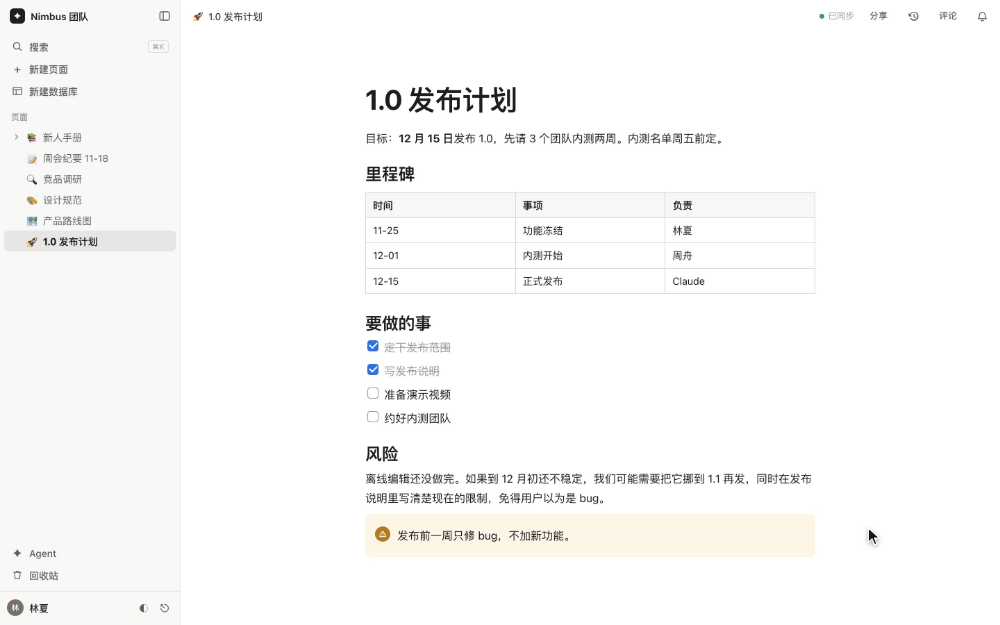
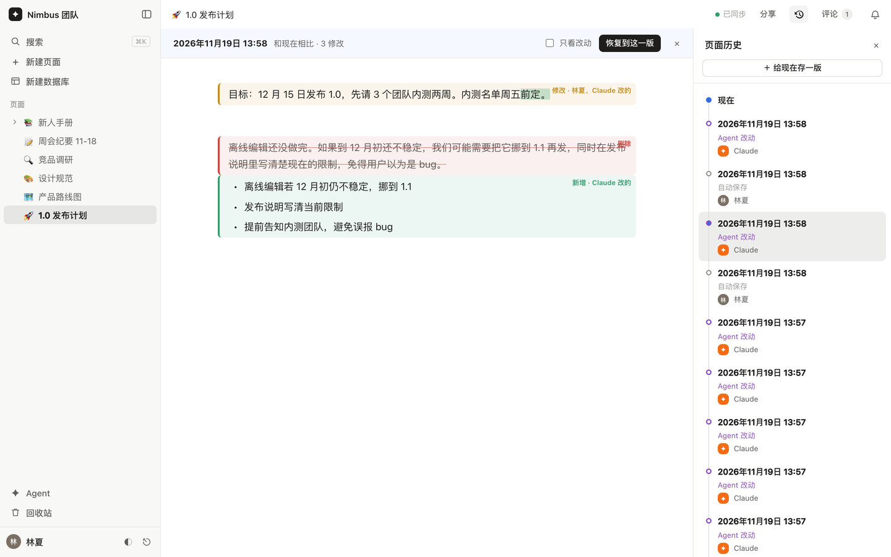
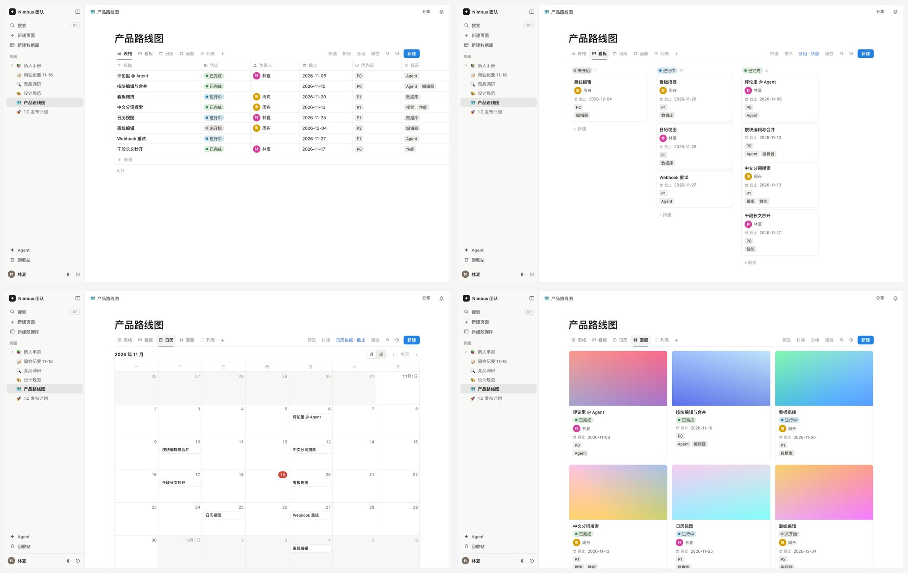
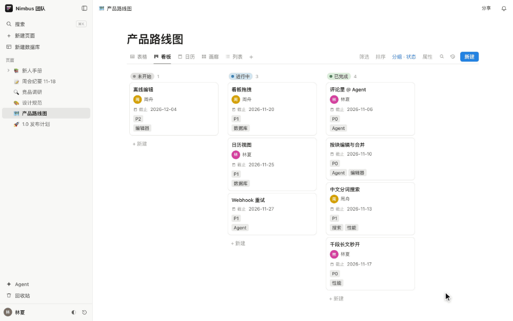
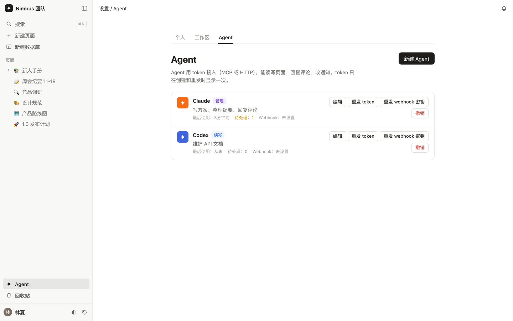

# Open Agent Docs

[English](README.md) | 简体中文

人和 AI Agent 一起写的文档。可以把它看成开源的 Notion，为 Agent 而生。

自己部署的文档服务器。Agent（Claude Code、Codex、各种 Bot、自己写的脚本）经 MCP 读写页面；人在浏览器里和它们同时编辑、评论、建数据库。



### Agent 实时写进页面

在 Claude Code 里交代一句，就能看着页面一块一块被写出来。顶栏显示谁正在写，鼠标停在某一块上能看到是谁写的。



### 按块改，自动合并

页面读出来是 Markdown，每块前面有块编号。Agent 只改想改的块，带回读到的版本，服务器合并，谁打的字都不会被覆盖。



### 评论能叫到 Agent

选中一段，在评论里 @ 它，或者评论它写的内容：它收到通知（webhook、SSE 或轮询），带着写好的提示词，改好以后在评论里回复。



### 每次改动都有记录

历史版本里分得清哪些是人改的、哪些是 Agent 改的，每一版都能看对比、能恢复。



### 数据库

表格、看板、日历、画廊、列表五种视图；单选、状态、日期、人员、文件、公式、关联、汇总、自动编号、按钮。每一行也是一个页面，Agent 一样能查、能填。





### 其他

- **人用的实时编辑器。** 多人协作的块编辑器，能看到别人在哪；子页面、回收站、公开分享、中英文搜索、中英文界面、深色模式，装成 PWA 能离线用。
- **能嵌进自己的应用。** 放一个 iframe，或者用 `@oad/client`、`@oad/editor` 两个包，登录用自己的。
- **一个程序，一个数据目录。** Rust 写的服务器，网页打在里面；SQLite。不到 30 MB，启动约 20 毫秒，空闲内存约 17 MB，十万段文字里搜索 p95 不到 9 毫秒（[测试数据](docs/baseline.md)）。

## 跑起来

```sh
docker run -d -p 8848:8848 -v oad-data:/data \
  -e OAD_ADMIN_EMAIL=me@example.com -e OAD_ADMIN_PASSWORD='自己定一个' ghcr.io/kadaliao/open-agent-docs
```

打开 http://127.0.0.1:8848 。不用下源码，镜像有 amd64 和 arm64 两种；用 Docker Compose 的话下载
[docker-compose.yml](docker-compose.yml) 就行。直接用二进制（[发布页](https://github.com/kadaliao/open-agent-docs/releases/latest)）、从源码编，见[快速开始](docs/zh/quickstart.md)。

接上 Claude Code（在网页的 **Agent** 里建一个，拿到 token）：




```sh
claude mcp add --transport http docs http://127.0.0.1:8848/mcp --header "Authorization: Bearer oad_..."
```

## 文档

- [快速开始](docs/zh/quickstart.md) · [配置](docs/zh/configuration.md) · [部署](docs/zh/deployment.md)
- [Agent](docs/zh/agents.md)（MCP、通知、webhook） · [Agent 看到的 Markdown](docs/zh/markdown.md)
- [嵌入到自己的应用](docs/zh/embedding.md)（JS 包、iframe、header 登录、JWT）
- [从旧版（Python）迁移](docs/zh/migration.md)

## 开发

```sh
pnpm install && sh packages/db-wasm/build.sh
cargo run -p oad-bin -- serve        # 服务器，:8848
pnpm dev                             # 网页（热更新，/api 转给 :8848）
pnpm -r test && cargo test           # 测试
```

旧的 Python 版在 git 标签 `python-final` 上；数据搬过来见[迁移](docs/zh/migration.md)。

## 许可

MIT
